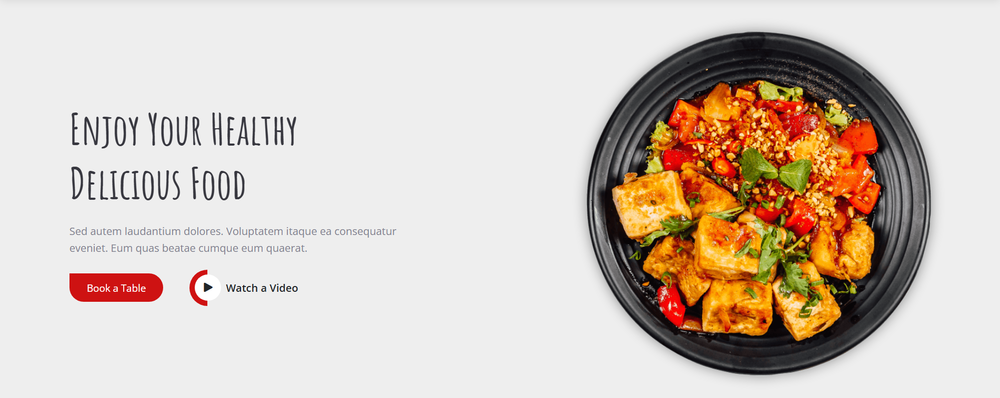
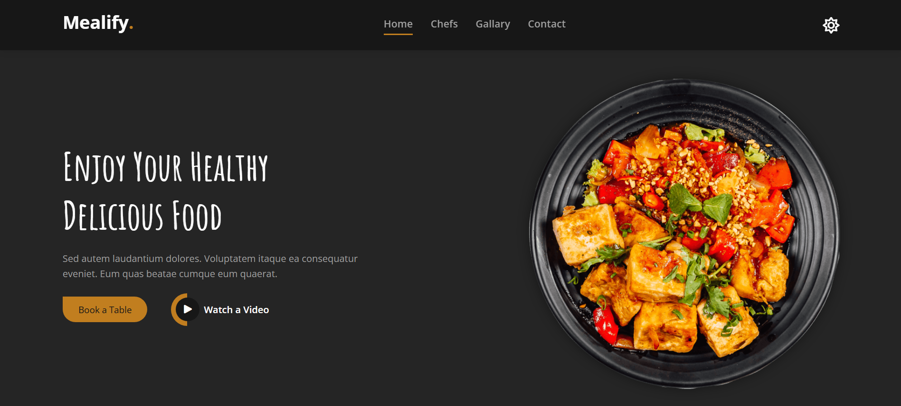

# Mealify Website Template — HTML & CSS

A modern restaurant landing page built with **pure HTML5 and CSS3**, inspired by the [Mealify website design](https://mealify-teal.vercel.app/). The project combines responsive layouts, custom animations, interactive image galleries, and CSS-only dark mode to recreate the reference design without JavaScript or CSS frameworks.

## 🌐 Live Demo

[**Explore the Live Website**](https://abdelrahmankishk.github.io/Mealify-Template/)

## 🖥️ Homepage Preview





## 📋 Overview

Mealify is a restaurant website template that presents a restaurant's identity, professional chefs, food gallery, contact information, and social media presence through a visually engaging, single-page layout.

The implementation focuses on translating the reference design into a responsive website while exploring advanced CSS selectors, animations, pseudo-elements, custom properties, and layout techniques. Particular attention is given to recreating the design's visual details and interactions using CSS alone.

## ✨ Features

- **Fixed Navigation:** Section-based navigation with smooth scrolling, hover indicators, and active-section styling.
- **Responsive Navbar:** A collapsible navigation menu on smaller screens, with CSS-controlled opening and closing.
- **Animated Hero Section:** Features a prominent food image with a custom shake animation on hover and styled call-to-action buttons.
- **Professional Chefs:** Profile cards with hover scaling, social media icon overlays, and a decorative SVG shape beneath the images.
- **Interactive Food Gallery:** Seven food images arranged in a multi-column layout with animated overlays, descriptive text, and zoom effects.
- **CSS-Only Dark Mode:** Switches between light and dark themes without JavaScript.
- **Responsive Layout:** Dedicated media queries adjust the page's navigation, hero, chef cards, gallery, contact section, and footer for different screen sizes.
- **Contact Section:** Includes an embedded Google Maps location, contact information cards, and a styled message form.
- **Multi-Section Footer:** Presents restaurant information, social media links, newsletter subscription UI, quick links, and contact details.
- **Consistent Visual Design:** Custom typography, reusable button styles, CSS transitions, shadows, and a coordinated color palette.

## 🛠️ Technologies & Tools

| Technology        | Application                                          |
| ----------------- | ---------------------------------------------------- |
| HTML5             | Page structure and content                           |
| CSS3              | Styling, animations, transitions, and visual effects |
| Google Fonts      | Open Sans, Inter, and Amatic SC typography           |
| Font Awesome Free | Icons and visual elements                            |
| GitHub Pages      | Website hosting and deployment                       |

**Implementation note:** The website is built entirely with HTML and CSS. No JavaScript libraries, JavaScript code, or CSS frameworks are used.

## 💡 Notable CSS Implementations

### 1. CSS-Only Dark Mode

Implemented theme switching with a checkbox, the `:has()` pseudo-class, and CSS custom properties. Changing the checkbox state updates shared theme variables, allowing colors across multiple sections to change without JavaScript.

### 2. Hero Image Shake Animation

Created a custom `@keyframes` animation using `transform`, translation, and rotation. The animation is triggered when the user hovers over the hero image, adding movement to the otherwise static landing page.

### 3. Responsive Navigation Without JavaScript

Used the `:target` pseudo-class to control the compact navigation menu through URL fragment targets. This enables the menu to open and close through links rather than a JavaScript event handler.

### 4. SVG-Based Decorative Styling

Integrated `team-shape.svg` as a CSS background image to create a decorative wave along the bottom of the chef images. This adds a distinctive visual detail while keeping the effect separate from the HTML content.

### 5. Multi-Column Gallery Layout

Built the food gallery using Flexbox, individually styled image containers, and responsive ordering rules. Hover states reveal overlay content with CSS transitions, while image scaling adds a zoom effect.

### 6. Responsive Styling Architecture

Separated general styling, responsive rules, and dark-mode styling into dedicated stylesheets. Media queries adjust component widths, layout directions, navigation behavior, and gallery organization at selected breakpoints.

### 7. Reusable CSS Design System

Defined shared colors, font families, and animation timing through CSS custom properties. Common button and heading styles help maintain consistency across the different sections.

## 📂 Project Structure

```text
Mealify-Template/
├── index.html
├── css/
│   ├── all.min.css
│   ├── styles.css
│   ├── media.css
│   └── dark-mode.css
├── img/
│   ├── Screenshot.png
│   ├── favicon.png
│   ├── hero-img.png
│   ├── chefs-1.jpg
│   ├── chefs-2.jpg
│   ├── chefs-3.jpg
│   ├── team-shape.svg
│   ├── meal-1.jpg
│   ├── meal-2.jpg
│   ├── meal-3.jpg
│   ├── meal-4.jpg
│   ├── meal-5.jpg
│   ├── meal-6.jpg
│   ├── meal-7.jpg
│   └── metal-background.jpg
└── webfonts/
```

## 🎨 Design Reference

[**View the Original Mealify Template**](https://mealify-teal.vercel.app/)

## 📌 Project Status

**Completed and deployed** on GitHub Pages.
